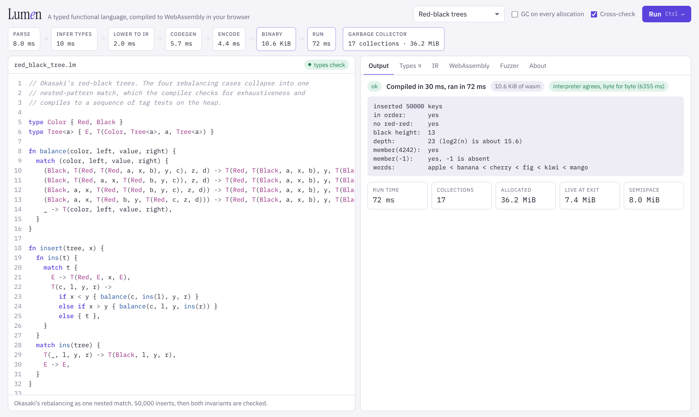

# Lumen

**A statically typed functional language with a from-scratch compiler to
WebAssembly.** It infers every type, proves every `match` exhaustive, converts
closures, compiles tail calls to `return_call`, and ships its own copying
garbage collector inside the binaries it emits. It is about 3,500 lines of
JavaScript with zero dependencies: no parser generator, no wasm toolchain,
no GC library.

Claude built this end to end in a single Claude Code session, as a
demonstration of long-horizon, self-verifying software engineering. The
repository also contains the tools used to check that the result is
correct, and a [challenge](CHALLENGE.md) for comparing models on the same
task.



```sh
npm test                                              # 40 tests, about 10 s
node bin/lumen.js run examples/red_black_tree.lm --stats
npm run serve                                         # playground at http://localhost:8080
node fuzz/fuzz.js --count 1000                        # differential fuzzing
node fuzz/mutants.js                                  # does the fuzzer catch planted bugs?
```

Requires Node.js 22 or later. The playground needs a browser with WebAssembly
tail calls: Chrome 112+, Firefox 121+ or Safari 18.2+.

## A taste

```rust
type Tree<a> { E, T(Color, Tree<a>, a, Tree<a>) }
type Color { Red, Black }

// Okasaki's red-black rebalancing: four rotations, one match.
fn balance(color, left, value, right) {
  match (color, left, value, right) {
    (Black, T(Red, T(Red, a, x, b), y, c), z, d) -> T(Red, T(Black, a, x, b), y, T(Black, c, z, d)),
    (Black, T(Red, a, x, T(Red, b, y, c)), z, d) -> T(Red, T(Black, a, x, b), y, T(Black, c, z, d)),
    (Black, a, x, T(Red, T(Red, b, y, c), z, d)) -> T(Red, T(Black, a, x, b), y, T(Black, c, z, d)),
    (Black, a, x, T(Red, b, y, T(Red, c, z, d))) -> T(Red, T(Black, a, x, b), y, T(Black, c, z, d)),
    _ -> T(color, left, value, right),
  }
}
```

There are no annotations anywhere, yet `node bin/lumen.js check` reports:

```
fn balance: fn(Color, Tree<a>, a, Tree<a>) -> Tree<a>
fn insert:  fn(Tree<a>, a) -> Tree<a>
fn lookup:  fn(List<(a, b)>, a) -> Option<b>        (from examples/huffman.lm)
```

Mistakes are caught at compile time and reported with a concrete
counterexample:

```
error: non-exhaustive match: pattern `(FlashingRed, None)` is not covered
 --> 7:9
  |
7 |   match (light, emergency) {
  |         ^^^^^^^^^^^^^^^^^^
  = note: add an arm for the missing case, or a wildcard `_ ->` arm
```

The full language is described in [SPEC.md](SPEC.md). The examples include
[an interpreter written in Lumen](examples/calculator.lm),
[Huffman coding](examples/huffman.lm), [N-queens](examples/nqueens.lm),
[Conway's Life](examples/life.lm), [the Mandelbrot set in fixed point](examples/mandelbrot.lm)
and [a GC torture test](examples/gc_torture.lm).

## How the compiler works

```mermaid
flowchart LR
  A[source] --> B[lexer + parser]
  B --> C[Hindley–Milner<br/>inference]
  C --> D[exhaustiveness<br/>Maranget]
  D --> E[lowering: ANF,<br/>closure conversion,<br/>match compilation]
  E --> F[codegen]
  F --> G[binary encoder]
  G --> H[(.wasm with<br/>runtime + GC)]
  C -. typed AST .-> I[reference<br/>interpreter]
```



| Phase | File | Lines | Notes |
| --- | --- | ---: | --- |
| Lexer, parser | `src/lexer.js`, `src/parser.js` | 526 | Precedence climbing; list literals and `\|>` are desugared |
| Types, inference | `src/types.js`, `src/typecheck.js` | 721 | Level-based generalization; top-level functions ordered by call-graph SCCs (Tarjan) |
| Exhaustiveness | `src/exhaustive.js` | 157 | Maranget's usefulness algorithm, with witnesses and redundancy warnings |
| Lowering | `src/lower.js` | 355 | A-normal form, closure conversion, lambda lifting, pattern compilation |
| Code generation | `src/codegen.js` | 362 | Shadow-stack frames, tail calls, static closures |
| Runtime and GC | `src/runtime.js` | 332 | Written as raw wasm instructions |
| Binary encoder | `src/wasm.js` | 342 | LEB128, sections, label resolution, name section, WAT printer |
| Reference interpreter | `src/interp.js` | 242 | Independent oracle for differential testing |
| Prelude | `src/prelude.js` | 188 | Lists, options and strings, written in Lumen |

### Design decisions

**Value representation.** Every value is one 32-bit word. Integers are
tagged as `(n << 1) | 1`, so they are 31-bit and wrap around. Booleans, unit
and nullary constructors are also odd immediates. Everything else is a
4-byte-aligned pointer to an object whose header is
`(size << 9) | (kind << 1) | 1`. Because pointers are always even and
headers always odd, the collector needs no type information. During a
collection, an even first word marks an object that has already been
forwarded. Tagged arithmetic stays cheap: `a + b` compiles to
`a + b - 1`.

**Garbage collection.** Cheney's copying algorithm, with semispaces that
double when more than half full after a collection. The roots live on a
*shadow stack* in linear memory, because wasm locals are invisible to a
collector. Two rules make rooting correct by construction:

1. The IR is in A-normal form, so no heap pointer ever sits on the wasm
   operand stack across a call or an allocation. Every intermediate value is
   a named variable.
2. Allocation sites load their fields *after* calling the allocator, because
   a collection inside the allocator may move them.

Types make it cheaper. Variables whose type can only hold immediates
(`Int`, `Bool`, enums) stay in plain wasm locals and never become roots.
`fib` needs no shadow frame at all and runs as plain wasm recursion.

**Calling convention.** Every function takes `(env, args…)`. Closures are
heap objects holding a function-table index and their captured values, and
they are called with `call_indirect`. Functions with no free variables get a
static closure in the data segment, so creating them allocates nothing.
Calls to known functions are direct. Calls in tail position pop the shadow
frame and use `return_call` / `return_call_indirect`, so loops written as
recursion run in constant stack.

**Structural equality and ordering** work on any type and are implemented
once in the runtime. They iterate instead of recursing on the last field, so
comparing two million-element lists does not overflow the stack.

## How it is verified

Each layer of evidence below checks the one before it.

| Evidence | What it shows |
| --- | --- |
| **Golden tests** for every example (`test/examples.test.js`) | Real programs produce exactly the recorded output, and the two error demos produce exactly the recorded diagnostics |
| **Three-way semantic tests** (`test/language.test.js`) | Each program runs in the interpreter, as wasm, and as wasm with a GC on every allocation; all three must agree |
| **Differential fuzzing** (`fuzz/`) | A type-directed generator writes random well-typed programs with closures, local recursion, nested matches, strings, and runtime errors. Over 11,000 programs have been run three ways with **zero disagreements**, including 1.6 million stress-mode collections |
| **Mutation testing** (`fuzz/mutants.js`) | 16 realistic compiler bugs are planted one at a time. The fuzzer catches **16 of 16**, most within 1–7 random programs |
| **Spec conformance** (`challenge/score.js`) | 340/340 on examples, spec probes and fuzz programs, for both the compiler and the interpreter |

Mutation testing is what makes the zero meaningful. When the fuzzer reports
no disagreements, we know it is capable of reporting them:

| Planted bug | Programs until caught |
| --- | ---: |
| `concat` forgets to root its arguments before allocating | 1 |
| GC scan skips the last field of every object | 1 (hang) |
| Function prologue does not zero its shadow-stack frame | 1 |
| Allocation loads fields before calling the allocator | 1 |
| Arguments evaluated before the callee expression | 1 |
| Pattern matching skips the "is a heap block" test | 1 |
| Tagged multiplication forgets to untag an operand | 1 |
| `int_to_string` drops the minus sign | 1 |
| `substring` forgets to root its argument | 1 |
| String comparison treats a prefix as greater | 4 |
| Binary operators evaluate the right operand first | 6 |
| Ordering puts nullary constructors after ones with fields | 7 |
| Structural equality ignores the last field | 7 |
| Captured variables read from the wrong closure slot | 11 |
| `substring` does not clamp a negative start | 21 |
| Division-by-zero check missing for `%` | 43 |

### Problems found during development

These are recorded as they happened.

- **A name collision in the wasm module.** The calculator example defines a
  function called `run`, which collided with the module's entry point and
  silently replaced it. Every compiler-generated name now contains `:`,
  which Lumen identifiers cannot.
- **A blind spot in the fuzzer**, found by mutation testing. The first run
  caught 15 of 16 planted bugs. The survivor (evaluating arguments before the
  callee) was invisible because the generator never produced a call whose
  callee *and* arguments both had side effects. The generator now does, and
  the bug is caught by the first program.
- **Generator bugs caught by the compiler.** One generated program contained
  `|x| x * 2 > |x| -x`, intended as a comparison of two lambdas. A lambda's
  body extends as far right as possible, so the type checker correctly
  rejected it as an infinite type. Generated lambdas are now parenthesized.
- **Weak error messages.** `[1, "two"]` originally reported
  `expected List<Int>, found List<String>` on the list's tail. List literals
  are now checked element by element, so the error points at `"two"`.
- **Bugs in the examples, caught by the language.** A first draft of the GC
  torture test built a tree out of bare nested lists, which the type checker
  rejected as an infinite type. The second draft recursed past zero. The
  compiled code and the interpreter both reported the same `stack overflow`.
- **Wrong test expectations.** Two hand-written expected values were wrong
  (46341² wraps to 4633 in 31 bits, and the missing case for
  `match xs { [] -> …, [x] -> … }` is `[_, _, .._]`). The implementation was
  right both times.

## Compare models

[CHALLENGE.md](CHALLENGE.md) turns this project into a reproducible
benchmark. Give any agent [SPEC.md](SPEC.md) and the brief, then score its
compiler automatically:

```sh
node challenge/score.js -- node /path/to/their/cli.js
```

## Limitations

Lumen is deliberately small. It has no floating point, no mutation, no
arrays, no modules, and no type classes; ordering is structural, and
comparing functions is a runtime error. Integers are 31 bits and strings are
bytes. Recursion within a group of mutually recursive functions is
monomorphic. The collector is a simple two-space copier, not a generational
or incremental one. Deep non-tail recursion is limited by the wasm stack and
reports `stack overflow`.

## Layout

```
src/         compiler, runtime and reference interpreter
examples/    example programs and their expected output
test/        node:test suites (npm test)
fuzz/        random program generator, differential fuzzer, mutation tester
challenge/   spec-conformance scorer and probes
playground/  browser playground (index.html at the repository root)
bin/         lumen CLI and a static file server
```
