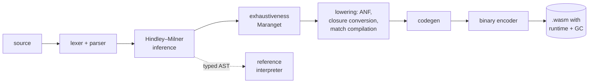

# Lumen

[](https://github.com/igniting/the-ai-frontier/actions/workflows/ci.yml)

**[Read how it was built →](https://igniting.github.io/the-ai-frontier/)** (a long-form explanation for engineers, with live demos) · **[Open the playground →](https://igniting.github.io/the-ai-frontier/playground.html)**

**A statically typed functional language with a from-scratch compiler to
WebAssembly.** It infers every type, proves every `match` exhaustive, converts
closures, compiles tail calls to `return_call`, and ships its own copying
garbage collector inside the binaries it emits. The compiler is about 4,000
lines of JavaScript with zero dependencies: no parser generator, no wasm
toolchain, no GC library.

Four things are built on top of it:

- **[The compiler compiles itself.](#self-hosting)** `selfhost/lumenc.lm` is
  the whole compiler rewritten in Lumen (3,300 lines). Compiled by the
  JavaScript compiler, it compiles its own source to a binary that compiles its
  own source to *the same binary*: a byte-identical fixed point. You can run
  this bootstrap in the browser.
- **[A superoptimizer with machine-checked proofs.](#a-superoptimizer-with-checked-proofs)**
  It mines the compiler's output for code with a shorter equivalent and proves
  each rewrite for all 2^32 inputs. The proof uses a SAT solver written for this
  project, and every refutation is re-checked by an independent proof checker.
  `-O` applies the 40 surviving rules.
- **[A gated performance campaign.](#the--o-campaign)** `-O` was built one
  profiled step at a time. Each step had to pass the tests, thousands of fresh
  fuzz programs run five ways, every planted bug, every proof, and the bootstrap
  before it was kept. The result:
  - 31% fewer executed instructions, and 15–61% less wall time on 9 of 10 timed
    benchmarks;
  - up to 2.9× the memory;
  - the default build unchanged byte for byte.
- **[A theorem, proved by the language.](#proving-s4--44-in-lumen)** A SAT
  solver written in Lumen proves the Schur number S(4) = 44:
  - it splits 1…44 into four sum-free groups;
  - it refutes 1…45 with a 255,663-step proof, which the independent checker
    validates.

  Lumen gained mutable arrays for this, with the value restriction that keeps
  them sound.

**[Lumen 2](lumen2/)** is a separate, newer language in this repository. Its
types track effects, including capabilities that `main` must be granted. It
proves array accesses and refinement types with checked SAT certificates,
and has traits and property-based tests in the language. Its compiler
certifies its own passes, and memory is managed by Perceus reference
counting with in-place reuse instead of a garbage collector. It is a fresh
design with its own compiler, interpreter, spec and fuzzer, and shares no
code with Lumen. A SAT solver written in Lumen 2 proves S(4) = 44 too,
printing the same 255,663-step refutation as Lumen's solver, byte for
byte. Lumen 2's compiler is written in Lumen 2 and compiles itself to
itself; it was ported from JavaScript pass by pass, wrote the same bytes as
the original for every program in a 1,086-program corpus, and replaced it. Its [showcase](lumen2/README.md#showcase) has a heapsort that is pure,
sorts a million numbers in place with 106 allocations, and is proved unable
to fail. The S(4) proof is also checked by a DRUP checker written in Lumen 2
whose every array access is proved in bounds, so it cannot crash. It has its own
[playground](https://igniting.github.io/the-ai-frontier/lumen2/playground.html),
and [Part five of the story](https://igniting.github.io/the-ai-frontier/#lumen2)
explains it.

Claude built this end to end in Claude Code, as a demonstration of
long-horizon, self-verifying software engineering. The repository also
contains the tools used to check that the result is correct, and a
[challenge](CHALLENGE.md) for comparing models on the same task.


```sh
npm test                                              # 54 tests, about 20 s
node bin/lumen.js run examples/red_black_tree.lm --stats [-O]
npm run serve                                         # playground at http://localhost:8080
node fuzz/fuzz.js --count 1000                        # differential fuzzing, five ways
node fuzz/mutants.js                                  # does the fuzzer catch planted bugs?
node selfhost/bootstrap.js                            # the self-hosted compiler's fixed point
node superopt/verify.js                               # re-prove every rewrite rule
node bench/bench.js                                   # -O vs the default build
```

Requires Node.js 22 or later. The playground needs a browser with WebAssembly
tail calls: Chrome 112+, Firefox 121+ or Safari 18.2+.

## A taste

```rust
type Tree<a> { E, T(Color, Tree<a>, a, Tree<a>) }
type Color { Red, Black }

// Okasaki's red-black rebalancing: four rotations, one match.
fn balance(color, left, value, right) {
  match (color, left, value, right) {
    (Black, T(Red, T(Red, a, x, b), y, c), z, d) -> T(Red, T(Black, a, x, b), y, T(Black, c, z, d)),
    (Black, T(Red, a, x, T(Red, b, y, c)), z, d) -> T(Red, T(Black, a, x, b), y, T(Black, c, z, d)),
    (Black, a, x, T(Red, T(Red, b, y, c), z, d)) -> T(Red, T(Black, a, x, b), y, T(Black, c, z, d)),
    (Black, a, x, T(Red, b, y, T(Red, c, z, d))) -> T(Red, T(Black, a, x, b), y, T(Black, c, z, d)),
    _ -> T(color, left, value, right),
  }
}
```

There are no annotations anywhere, yet `node bin/lumen.js check` reports:

```
fn balance: fn(Color, Tree<a>, a, Tree<a>) -> Tree<a>
fn insert:  fn(Tree<a>, a) -> Tree<a>
fn lookup:  fn(List<(a, b)>, a) -> Option<b>        (from examples/huffman.lm)
```

Mistakes are caught at compile time and reported with a concrete
counterexample:

```
error: non-exhaustive match: pattern `(FlashingRed, None)` is not covered
 --> 7:9
  |
7 |   match (light, emergency) {
  |         ^^^^^^^^^^^^^^^^^^
  = note: add an arm for the missing case, or a wildcard `_ ->` arm
```

The full language is described in [SPEC.md](SPEC.md). The examples include
[an interpreter written in Lumen](examples/calculator.lm),
[Huffman coding](examples/huffman.lm), [N-queens](examples/nqueens.lm),
[Conway's Life](examples/life.lm), [the Mandelbrot set in fixed point](examples/mandelbrot.lm)
and [a GC torture test](examples/gc_torture.lm).

## How the compiler works



| Phase | File | Lines | Notes |
| --- | --- | ---: | --- |
| Lexer, parser | `src/lexer.js`, `src/parser.js` | 526 | Precedence climbing; list literals and `\|>` are desugared |
| Types, inference | `src/types.js`, `src/typecheck.js` | 721 | Level-based generalization; top-level functions ordered by call-graph SCCs (Tarjan) |
| Exhaustiveness | `src/exhaustive.js` | 157 | Maranget's usefulness algorithm, with witnesses and redundancy warnings |
| Lowering | `src/lower.js` | 355 | A-normal form, closure conversion, lambda lifting, pattern compilation |
| Code generation | `src/codegen.js` | 362 | Shadow-stack frames, tail calls, static closures |
| Runtime and GC | `src/runtime.js` | 332 | Written as raw wasm instructions |
| Binary encoder | `src/wasm.js` | 342 | LEB128, sections, label resolution, name section, WAT printer |
| Reference interpreter | `src/interp.js` | 242 | Independent oracle for differential testing |
| Prelude | `src/prelude.js` | 188 | Lists, options and strings, written in Lumen |

### Design decisions

**Value representation.** Every value is one 32-bit word. Integers are
tagged as `(n << 1) | 1`, so they are 31-bit and wrap around. Booleans, unit
and nullary constructors are also odd immediates. Everything else is a
4-byte-aligned pointer to an object whose header is
`(size << 9) | (kind << 1) | 1`. Because pointers are always even and
headers always odd, the collector needs no type information. During a
collection, an even first word marks an object that has already been
forwarded. Tagged arithmetic stays cheap: `a + b` compiles to
`a + b - 1`.

**Garbage collection.** Cheney's copying algorithm, with semispaces that
double when more than half full after a collection. The roots live on a
*shadow stack* in linear memory, because wasm locals are invisible to a
collector. Two rules make rooting correct by construction:

1. The IR is in A-normal form, so no heap pointer ever sits on the wasm
   operand stack across a call or an allocation. Every intermediate value is
   a named variable.
2. Allocation sites load their fields *after* calling the allocator, because
   a collection inside the allocator may move them.

Types make it cheaper. Variables whose type can only hold immediates
(`Int`, `Bool`, enums) stay in plain wasm locals and never become roots.
`fib` needs no shadow frame at all and runs as plain wasm recursion.

**Calling convention.** Every function takes `(env, args…)`. Closures are
heap objects holding a function-table index and their captured values, and
they are called with `call_indirect`. Functions with no free variables get a
static closure in the data segment, so creating them allocates nothing.
Calls to known functions are direct. Calls in tail position pop the shadow
frame and use `return_call` / `return_call_indirect`, so loops written as
recursion run in constant stack.

**Structural equality and ordering** work on any type and are implemented
once in the runtime. They iterate instead of recursing on the last field, so
comparing two million-element lists does not overflow the stack.

## How it is verified

Each layer of evidence below checks the one before it.

| Evidence | What it shows |
| --- | --- |
| **Golden tests** for every example (`test/examples.test.js`) | Real programs produce exactly the recorded output, and the two error demos produce exactly the recorded diagnostics |
| **Five-way semantic tests** (`test/language.test.js`) | Each program runs in the interpreter and as four wasm builds: default and `-O`, each with and without a GC on every allocation. All five must agree |
| **Differential fuzzing** (`fuzz/`) | A type-directed generator writes random well-typed programs with closures, local recursion, nested matches, strings, and runtime errors. Over 40,000 programs have been run this way. The only disagreement was a real bug in the reference interpreter, now fixed (below) |
| **Mutation testing** (`fuzz/mutants.js`) | 27 realistic compiler and optimizer bugs are planted one at a time. The fuzzer catches **27 of 27**, most within 1–8 random programs |
| **Self-hosting** (`selfhost/`) | An independent second implementation of the whole compiler, in Lumen, emits byte-identical binaries for the examples and hundreds of fuzz programs, and identical error messages |
| **Proofs** (`superopt/verify.js`) | Every rewrite rule `-O` applies is re-proved by SAT, the proof is RUP-checked, and both sides are random-tested |
| **Spec conformance** (`challenge/score.js`) | 340/340 on examples, spec probes and fuzz programs, for both the compiler and the interpreter |

Mutation testing is what makes the zero meaningful. When the fuzzer reports
no disagreements, we know it is capable of reporting them:

| Planted bug | Programs until caught |
| --- | ---: |
| `concat` forgets to root its arguments before allocating | 1 |
| GC scan skips the last field of every object | 1 (hang) |
| Function prologue does not zero its shadow-stack frame | 1 |
| Allocation loads fields before calling the allocator | 1 |
| Arguments evaluated before the callee expression | 1 |
| Pattern matching skips the "is a heap block" test | 1 |
| Tagged multiplication forgets to untag an operand | 1 |
| `int_to_string` drops the minus sign | 1 |
| `substring` forgets to root its argument | 1 |
| String comparison treats a prefix as greater | 4 |
| Binary operators evaluate the right operand first | 6 |
| Ordering puts nullary constructors after ones with fields | 7 |
| Structural equality ignores the last field | 7 |
| Captured variables read from the wrong closure slot | 11 |
| `substring` does not clamp a negative start | 21 |
| Division-by-zero check missing for `%` | 43 |
| `-O`: a superoptimizer rule is off by one (`x >>> 1 == 0` becomes `x <u 1`) | 18 |
| `-O`: a self tail call assigns the arguments to the wrong parameters | 1 |
| `-O`: a self tail call loops back past the prologue | 1 |
| `-O`: load forwarding keeps values across calls that may collect | 1 |
| `-O`: load forwarding merges paths by union | 180 |
| `-O`: frame zeroing ignores direct calls as GC points | 1 |
| `-O`: frame zeroing trusts writes made inside an `if` | 8 |
| `-O`: inline allocation forgets to bump the heap pointer | 1 |
| `-O`: the heap-growth test is inverted | 1 |
| `-O`: temporary forwarding deletes a store still read later | 1 |
| `-O`: the constant folder swaps the operands of subtraction | 1 |

### Problems found during development

These are recorded as they happened.

- **A name collision in the wasm module.** The calculator example defines a
  function called `run`, which collided with the module's entry point and
  silently replaced it. Every compiler-generated name now contains `:`,
  which Lumen identifiers cannot.
- **A blind spot in the fuzzer**, found by mutation testing. The first run
  caught 15 of 16 planted bugs. The survivor (evaluating arguments before the
  callee) was invisible because the generator never produced a call whose
  callee *and* arguments both had side effects. The generator now does, and
  the bug is caught by the first program.
- **Generator bugs caught by the compiler.** One generated program contained
  `|x| x * 2 > |x| -x`, intended as a comparison of two lambdas. A lambda's
  body extends as far right as possible, so the type checker correctly
  rejected it as an infinite type. Generated lambdas are now parenthesized.
- **Weak error messages.** `[1, "two"]` originally reported
  `expected List<Int>, found List<String>` on the list's tail. List literals
  are now checked element by element, so the error points at `"two"`.
- **Bugs in the examples, caught by the language.** A first draft of the GC
  torture test built a tree out of bare nested lists, which the type checker
  rejected as an infinite type. The second draft recursed past zero. The
  compiled code and the interpreter both reported the same `stack overflow`.
- **Wrong test expectations.** Two hand-written expected values were wrong
  (46341² wraps to 4633 in 31 bits, and the missing case for
  `match xs { [] -> …, [x] -> … }` is `[_, _, .._]`). The implementation was
  right both times.
- **A bug in the reference interpreter**, found by fresh-seed fuzzing. A
  generated program grew a string eightfold per step past 8 MiB. Compiled code
  stopped with `string too long`, but the interpreter carried on. The limit had
  never been written down. SPEC.md now states it, and the interpreter enforces
  it.
- **Stale roots that were caught only by luck.** A planted bug in frame-zeroing
  elision survived 400 programs. A stale shadow-stack slot is harmless unless it
  happens to point into the current semispace. `-O` with GC stress is now a
  paranoid mode: popped frames are poisoned and the collector validates every
  root, so the bug is caught after 8 programs.
- **A wrong reference implementation.** The naive RUP checker written to
  cross-check the fast one disagreed with it on the first instance. The naive
  one was wrong: it missed unit clauses with repeated literals.
- **A false alarm from the benchmark harness.** It deleted the baseline's output
  before comparing against it, and reported that `-O` miscompiled the
  self-hosted compiler. The outputs were in fact identical.

## Self-hosting

`selfhost/src/*.lm` is the compiler again, written in Lumen. It covers the
same lexer, parser, Hindley–Milner inference, Maranget exhaustiveness
checking, lowering to A-normal form, closure conversion, code generator,
garbage-collected runtime and binary encoder. `selfhost/build.js` joins the
parts into `selfhost/lumenc.lm`. The program reads its input with
`read_input()` and writes a wasm binary to standard output. It differs from
the JavaScript version where Lumen forces it to:
- there is no mutation, so the type substitution is threaded through
  explicitly and maps are persistent AVL trees;
- output is a rope of byte strings with cached sizes.

```sh
node selfhost/bootstrap.js     # stage 1 (built by JS) = stage 2 (built by stage 1) = stage 3, byte for byte
node selfhost/check-phase.js types examples/huffman.lm    # compare any phase with the reference
```

Each phase was brought up against the reference compiler's output for that
phase: tokens, then syntax trees, types, IR and finally binaries. The fixed
point is a 274 KiB binary with SHA-256 `a40f2d5ad4456845…`. In the
playground's *Self-hosting* tab you can rebuild it in the browser, or compile
the editor's program with lumenc and compare it with the JavaScript
compiler's output.

## A superoptimizer with checked proofs

`superopt/` searches for shorter code and accepts nothing it cannot prove:
- **Mining.** `corpus.js` collects windows of straight-line i32 code from the
  compiler's output on the examples and 60 random programs.
- **Synthesis.** `synth.js` enumerates candidate replacements, evaluating each
  on 48 test inputs at once. A candidate that matches on all of them is passed
  to the prover. A counterexample becomes a new test input (counterexample-
  guided synthesis).
- **Proof.** `bv.js` bit-blasts both sides into CNF. `sat.js`, a CDCL solver
  written here (watched literals, first-UIP learning, VSIDS, restarts), shows
  the two sides cannot differ for any input. It records every learned clause.
- **Checking.** `rup.js` is an independent checker. It re-derives each learned
  clause by unit propagation before the rule is accepted.
- **Generalization.** Constants are generalized to symbols proved for all
  values, sometimes under a side condition (`K ≥ 0`) that the compiler then
  checks. Assumptions the proof doesn't need, such as "this local holds a tagged
  integer, so it is odd", are dropped.

Discoveries include `(x < 0) << 1 | 1 ⇒ x >>> 30 | 1`, and
`!((4 − x) >>> 1) ⇒ x == 3` for odd `x`. The most useful is a family that
deletes six of the seven instructions where a comparison is boxed into a
tagged boolean and immediately unboxed. Search runs to a fixed point: it
re-mines code already rewritten by the rules found so far, which also repaired
one case where greedy rewriting got stuck.

The catalogue is [superopt/RULES.md](superopt/RULES.md). `node superopt/verify.js --emit DIR` writes every
formula and proof as DIMACS/DRUP, so a third-party checker such as drat-trim
can confirm them; CI uploads these files.

## The `-O` campaign

`-O` was developed as a loop:
1. Profile where executed instructions go (`bench/profile.js`).
2. Change one thing.
3. Pass the gate (`bench/gate.js`): tests, 4,500 fresh fuzz programs run five
   ways, every planted bug caught, every rule re-proved, and the bootstrap.
4. Measure, then keep or revert.

The primary metric is executed wasm instructions, which is deterministic.
Wall time comes from interleaved A/B runs in a single process. The kept steps:
- forward temporaries and frame-slot loads;
- give the heap more headroom and inline allocation;
- zero only the frame slots a collection could see unwritten;
- turn self tail calls into loops;
- re-mine the rules to a fixed point.

[CAMPAIGN.md](CAMPAIGN.md) records every step with its numbers, the
experiments that were rejected, and the costs.


## Proving S(4) = 44 in Lumen

A Schur number S(k) is the largest n for which 1…n can be split into k groups
with no group containing x, y and x + y. S(4) = 44 was found by computer search
in 1965. S(5) = 160 was proved in 2017 with a SAT proof of about two petabytes.
`proofs/` proves S(4) = 44 with Lumen programs and checks every step with
something independent of it:

1. **Encoding.** `proofs/schur.lm` (Lumen) writes both formulas, and a second
   encoder in JavaScript must produce the identical clauses.
2. **The split.** `proofs/sat.lm`, a CDCL SAT solver written in Lumen, splits
   1…44 into four groups. The groups are checked against the definition
   directly, not against the formula.
3. **The refutation.** The same solver refutes 1…45 and prints each learned
   clause, 255,663 in all. `superopt/rup.js` re-derives every one by unit
   propagation.

The one step a reader has to accept is "without loss of generality": groups
are interchangeable, so 1 can be put in group 1, and 2 = 1 + 1 then in
group 2.

```sh
node proofs/prove-schur.js 4 44 --out schur-proof/   # about 5 minutes; writes the CNFs and the DRUP proof
node proofs/prove-schur.js 3 13                      # under a second
```

CI runs the S(4) proof on every push and uploads the two formulas and the
refutation as the `schur-proof` artifact, in DIMACS and DRUP, the formats that
standard checkers such as drat-trim read (`drat-trim schur-4-45.cnf schur-4-45.drup`).

The proof needed the language to change. A SAT solver needs arrays it can
update in place, so Lumen gained `Array`, in both compilers, the interpreter,
the spec, the fuzzer and the planted bugs. Mutation then required ML's value
restriction: without it, `let a = array_make(1, [])` could be written as a list
of numbers and read back as a list of strings.

The solver also became a benchmark, and its profile set two more `-O` steps:
inline array access, and no shadow-stack frame for functions that provably
cannot reach the allocator. Both are described in [CAMPAIGN.md](CAMPAIGN.md).

## Compare models

[CHALLENGE.md](CHALLENGE.md) turns this project into a reproducible
benchmark. Give any agent [SPEC.md](SPEC.md) and the brief, then score its
compiler automatically:

```sh
node challenge/score.js -- node /path/to/their/cli.js
```

## Limitations

Lumen is deliberately small. It has no floating point, no modules, and no
type classes, and its only mutable values are arrays (added so that Lumen
could run a SAT solver); ordering is structural, and
comparing functions is a runtime error. Integers are 31 bits and strings are
bytes. Recursion within a group of mutually recursive functions is
monomorphic. The collector is a simple two-space copier, not a generational
or incremental one. Deep non-tail recursion is limited by the wasm stack and
reports `stack overflow`.

## Layout

```
src/         compiler, runtime, -O passes and reference interpreter
selfhost/    the compiler written in Lumen, its build and bootstrap checks
proofs/      a SAT solver and a Schur encoder written in Lumen; S(4) = 44
superopt/    superoptimizer: SAT solver, RUP checker, bit-blaster, search
bench/       benchmarks, profiler, A/B timer, the campaign's gate and charts
examples/    example programs and their expected output
test/        node:test suites (npm test)
fuzz/        random program generator, differential fuzzer, mutation tester
challenge/   spec-conformance scorer and probes
playground/  browser playground (playground.html at the repository root)
story/       the story page's live demos (index.html at the repository root)
lumen2/      Lumen 2, a separate language: effect types, Perceus reference counting
bin/         lumen CLI and a static file server
```
